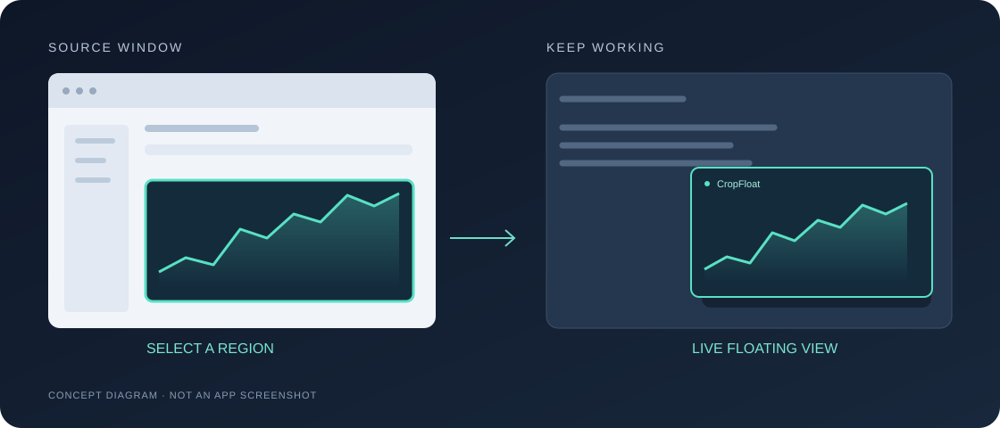

# CropFloat

**Turn part of a window into a live, floating view.**

macOS 14+ · Apple Silicon · MIT License

**English** · [Chinese](README.zh-CN.md)

CropFloat is a live region viewer for macOS. Select a window, crop an area, and watch it update in a small, movable, resizable window that stays on top.

Keep a browser's camera feed visible while writing a document, or watch a long-running task's progress without switching windows.

## Release status

**0.0.1 · Alpha in preparation.** Developer ID signing is complete. Apple notarization and installation checks are pending, so no public installer is available yet. Homebrew installation will be added after verification.

## How it works

| ① Choose a window | ② Select an area | ③ Float the view |
| :--- | :--- | :--- |
| Click **Choose Window…** and authorize a window in the system picker. | Drag in the live preview to select the area you want. | Click **Pin Selected Region**, then move or resize the floating view. |

The app defaults to English. Simplified Chinese is available from the interface or menus.

## Controls

- **Click-through** — interact with the content underneath; restore interaction from the menu bar.
- **Pause and resume** — stop capture while keeping the last frame, then resume when needed.
- **Frame rate** — choose 15 or 30 fps.
- **Stop capture** — use the menu bar or close the floating view. Closing only the editor leaves capture running.

## Privacy

Frames are processed on your Mac. No recording to disk, uploads, audio capture, analytics, or tracking. Only your language preference is saved.

The system authorizes the **whole source window**; CropFloat crops it locally for display. The current app is sandboxed and has no network entitlement.

[Read the privacy policy](privacy-en.html)

## Current limitations

- One source window and one floating view at a time. Selections are not restored after quitting.
- The selection follows window coordinates, not content. Scrolling or layout changes may require a new crop; reselect the source after major aspect-ratio changes.
- Minimizing or closing the source, locking the screen, or protected content can interrupt or freeze the image. Do not rely on it as an alarm system.
- Full-screen behavior, multiple displays, accessibility, sustained energy use, and macOS 14 compatibility still need validation. Capture is capped at 1920 pixels on the longest edge.

## About this repository

This repository hosts distribution documentation and future downloads. The source repository is currently private. The application is licensed under MIT.

## Support and license

Questions or private security reports: [xinyuwang1209@gmail.com](mailto:xinyuwang1209@gmail.com). Please omit sensitive screen contents.

[MIT License](LICENSE) · © 2026 Xinyu Wang
